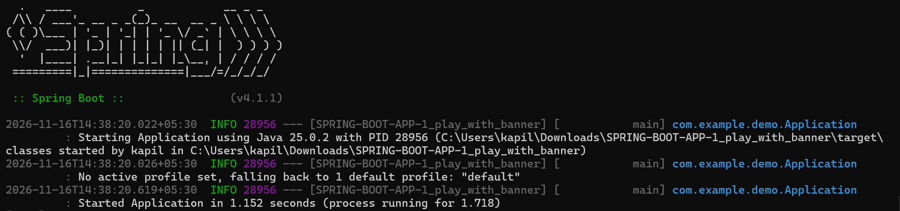
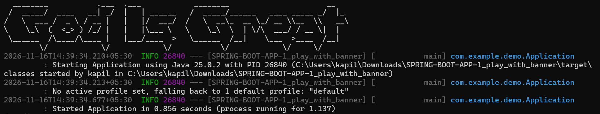
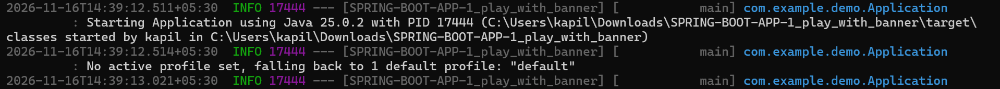

# Spring Boot Banner Demo

The first Spring Boot application. It demonstrates how to customize or turn off the startup banner, and how to set the application name.

###### Spring Boot Version: 4.1.1

## What this app demonstrates

- The default Spring Boot startup banner
- A custom banner loaded from `src/main/resources/banner.txt`
- Turning off the banner with `spring.main.banner-mode=off`
- Setting the application name with `spring.application.name`

## Prerequisites
- Java 17 or higher.
- Maven is included via the Maven Wrapper; no separate Maven installation is needed.

## Running
- Import this project into the Spring-Tool-Suite (STS) and run as spring boot application (Alt + Shift + X, B)
- or Simply run the command mvnw.cmd clean spring-boot:run from the root folder of the project in the terminal

## Configuration

The application name in `src/main/resources/application.properties`:

```
spring.application.name=my-first-spring-boot-app
```

To turn off the banner, add this property:

```
spring.main.banner-mode=off
```

To customize the banner, create or edit `src/main/resources/banner.txt`.

## Screenshots

### Default banner (no banner.txt, no spring.main.banner-mode=off)



### Custom banner (with banner.txt, no spring.main.banner-mode=off)



### Banner turned off (with spring.main.banner-mode=off)

