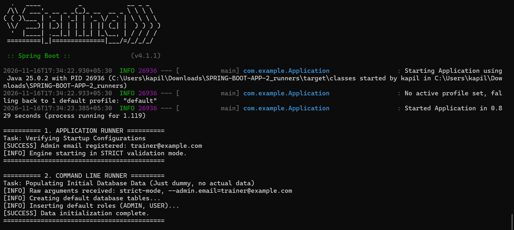

# Spring Boot Runner Demo

The second Spring Boot application. It demonstrates how to use runner in the Spring boot application. 

###### Spring Boot Version: 4.1.1

## What this app demonstrates

- Both the CommandLineRunner and the ApplicationRunner
- How to handle option argument and Non-option argument
- The ApplicationArgument class to handle program arguments 

## Prerequisites
- Java 17 or higher.
- Maven is included via the Maven Wrapper; no separate Maven installation is needed.

## Running
- Import this project into the Spring-Tool-Suite (STS) and run as spring boot application (Alt + Shift + X, B)
- or Simply run the command `mvnw.cmd clean spring-boot:run -Dspring-boot.run.arguments="strict-mode --admin.email=trainer@example.com"` from the root folder of the project in the terminal

## Configuration

The application name in `src/main/resources/application.properties`:

```
spring.application.name=SPRING-BOOT-APP-2_runners
```

## Screenshots

### Output

