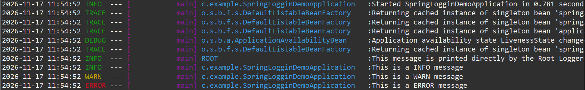

# Spring Boot Logging Demo

The third Spring Boot application. It demonstrates on how to root logger and setting log related properties using yml file. Setting log pattern for file and console.

###### Spring Boot Version: 4.1.1

## What this app demonstrates

- Getting Root Logger and class level logger
- Setting different log levels for root and for a package
- Setting the log format for console and file
- Writing log to a file

## Prerequisites
- Java 17 or higher.
- Maven is included via the Maven Wrapper; no separate Maven installation is needed.

## Running
- Import this project into the Spring-Tool-Suite (STS) and run as spring boot application (Alt + Shift + X, B)
- or Simply run the command `mvnw.cmd clean spring-boot:run"` from the root folder of the project in the terminal

## Configuration

The application name in `src/main/resources/application.yml`:

```
spring:
  application:
    name: SpringLogginDemo


logging:
  level:
    root: TRACE #The logging level for the entire application
    com.example: INFO #The logging level for the com.example package
  pattern:
    console: "%clr(%d{yyyy-MM-dd HH:mm:ss}){faint} %clr(%-5level) %clr(---){faint} %clr([%15.15thread]){magenta} %clr(%-40.40logger{39}){cyan}:%msg%n"
    file: "[%-5level] %d{yyyy-MM-dd HH:mm:ss} --- %-40.40logger{39}:%msg%n"
  file:
    name: logs/application.logs
```

## Screenshots

### Output

