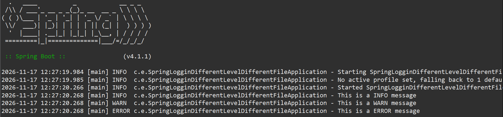
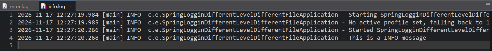
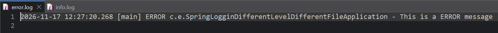

# Spring Boot Different Log Level Messages to Different Files

The fourth Spring Boot application. It demonstrates on how to write different different log level messages to different files.

###### Spring Boot Version: 4.1.1

## What this app demonstrates

- All log related configurations are written to logback-spring.xml file instead of application.properties file.
- Writing ERROR log level and INFO log level messages to different files.
- The log/error.log file and the log/info.log file contains error and info log level messages respectively.
- Last 30 days log files will be maintained and older log files will be deleted automatically by spring.

## Prerequisites
- Java 17 or higher.
- Maven is included via the Maven Wrapper; no separate Maven installation is needed.

## Running
- Import this project into the Spring-Tool-Suite (STS) and run as spring boot application (Alt + Shift + X, B)
- or Simply run the command `mvnw.cmd clean spring-boot:run"` from the root folder of the project in the terminal

## Configuration

The application name in `src/main/resources/application.properties`:

```
spring.application.name=SpringLogginDifferentLevelDifferentFile
```

## Screenshots

### Output
Log messages on console


Log messages in info.log file


Log messages in error.log file
