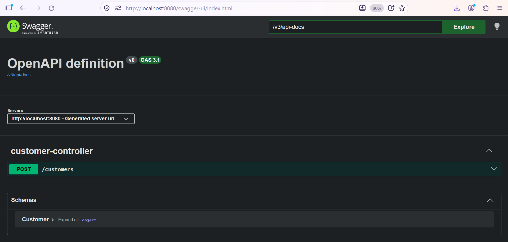

# Spring Boot Validation Example

The eighth Spring Boot application. It demonstrates on how to validate the input received from the front end.

###### Spring Boot Version: 4.1.1

## What this app demonstrates

- Reading validation messages from ValidationMessages.properties file
- Using spring-boot-starter-validation dependency with validation on minimum permission value, minimum length string, date of past or present, email and mobile number pattern.
- Validation Error messages are logged also with all logging configurations in the logback-spring.xml file.
- Swagger is also used here to show the API endpoints. Open http://localhost:8080/v3/api-docs and http://localhost:8080/swagger-ui/index.html in browser

## Prerequisites
- Java 17 or higher.
- Maven is included via the Maven Wrapper; no separate Maven installation is needed.
- Postman to hit API endpoint

## Running
- Import this project into the Spring-Tool-Suite (STS) and run as spring boot application (Alt + Shift + X, B)
- or Simply run the command `mvnw.cmd clean spring-boot:run"` from the root folder of the project in the terminal
- Use postman to hit API end-point with POST request

````
POST http://localhost:8080/customers
{
  "id": 0,
  "name": "A",
  "lastPurchaseDate": "2026-08-30",
  "email": "a@b.in",
  "mobile": "988653252"
}

````
## Configuration

The application name in `src/main/resources/application.properties`:

```
spring.application.name=Valid_Annotation_Example
```

## Output
````
{
  "detail": "Input validation failed. Please check the provided fields.",
  "instance": "/customers",
  "status": 400,
  "title": "Invalid Input",
  "invalid_fields": {
    "lastPurchaseDate": "Last purchase date must not be of future.",
    "name": "Customer name must be of two characters at least",
    "mobile": "Invalid mobile number",
    "id": "Customer id must be a positive value"
  }
}
````

## Screen-Shot
