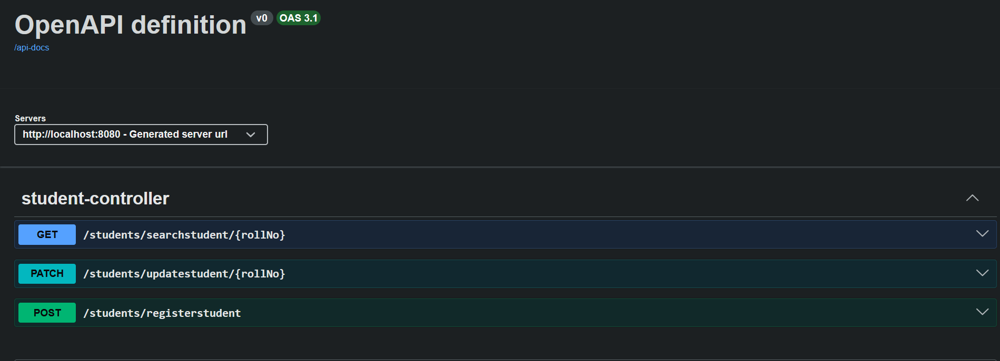

# Spring Boot Validation Example

The ninth Spring Boot application. It demonstrates on how to validate the input received from the front end such that input validation is performed using spring specific annotation.

###### Spring Boot Version: 4.1.1

## What this app demonstrates

- Reading validation messages from ValidationMessages.properties file
- The @Validated annotation
- Separate validation groups for create and update operation using marker interfaces
- Validation on the values received using @PathVariable
- Exception Handling for ConstraintViolationException and MethodArgumentNotValidException class
- Validation error messages from ValidationMessages.properties file

## Prerequisites
- Java 17 or higher.
- Maven is included via the Maven Wrapper; no separate Maven installation is needed.
- Postman to hit API endpoint

## Running
- Import this project into the Spring-Tool-Suite (STS) and run as spring boot application (Alt + Shift + X, B)
- or Simply run the command `mvnw.cmd clean spring-boot:run` from the root folder of the project in the terminal
- Use postman to hit API end-points

## Configuration

The application name in `src/main/resources/application.properties`:

```
spring.application.name=ValidationGroup_Practice_Exception_Handling
springdoc.api-docs.path=/api-docs
springdoc.swagger-ui.url=/api-docs
springdoc.swagger-ui.operationsSorter=method
```

## Output
POST http://localhost:8080/students/registerstudent

Request Body

```
{
  "rollNo":"13",
  "name": "DEF",
  "marks": 70.65
}
```

Output

```
{
  "rollNo":"13",
  "name": "DEF",
  "marks": 70.65
}
```


POST http://localhost:8080/students/registerstudent

```
{
  "rollNo":"0",
  "name": "K",
  "marks": -70
}
```

Output

```
{
  "detail": "Object validation failed. Please check the payload.",
  "instance": "/students/registerstudent",
  "status": 400,
  "title": "Invalid Request Body",
  "invalid_fields": {
    "rollNo": "Roll number must have a positive value",
    "marks": "Mark cannot have a negative value"
  }
 }
```


PATCH http://localhost:8080/students/updatestudent/10


Request Body

```
{
  "rollNo":"10",	//this is optional
  "name": "CBA",
  "marks": 56.75
 }
```

Output

```
{
  "rollNo": 10,
  "name": "CBA",
  "marks": 54.75
}
```


PATCH http://localhost:8080/students/updatestudent/101

Request Body

```
{
  "rollNo": 10,
  "name": "BCA",
  "marks": 54.75
}
```

Output

```
{
  "detail": "URL parameter validation failed.",
  "instance": "/students/updatestudent/101",
  "status": 400,
  "title": "Invalid URL Parameter",
  "invalid_params": {
    "rollno": "Roll number must be between 1 and 100"
  }
}
```


PATCH http://localhost:8080/students/updatestudent/10

Request Body

```
{
  "name": "",
  "marks": -54.75
}
```

Output

```
{
  "detail": "Object validation failed. Please check the payload.",
  "instance": "/students/updatestudent/10",
  "status": 400,
  "title": "Invalid Request Body",
  "invalid_fields": {
    "name": "Name is mandatory",
    "marks": "Mark cannot have a negative value"
  }
}
```


GET http://localhost:8080/students/searchstudent/10

Output

```
{
  "rollNo": 10,
  "name": "CBA",
  "marks": 55.65
}
```


GET http://localhost:8080/students/searchstudent/101


Output

```
{
  "detail": "URL parameter validation failed.",
  "instance": "/students/searchstudent/101",
  "status": 400,
  "title": "Invalid URL Parameter",
  "invalid_params": {
    "rollno": "Roll number must be between 1 and 100"
  }
}
```

## Screen-Shot
